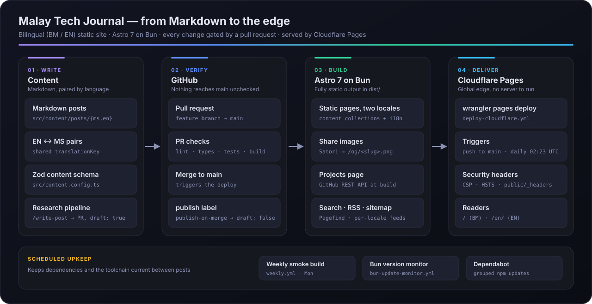

# Malay Tech Journal

A bilingual (Bahasa Melayu / English) blog on cloud security, AI guardrails and defence tech, for
engineers who build and defend production systems.

[](https://malay-tech-journal.pages.dev)
[](https://github.com/arifbazli/malay-tech-journal/actions/workflows/pr-checks.yml)
[](https://astro.build)



**Stack:** Astro 7 (static) · TypeScript · Tailwind CSS 4 · Bun · Pagefind · Cloudflare Pages

## Quick start

```bash
bun install
bun run dev       # http://localhost:4321
bun run build     # dist/ + search index
```

Before a PR: `bun run lint && bun run typecheck && bun run format:check && bun test`

## Write and publish

1. Add `src/content/posts/ms/<slug>.md` and `src/content/posts/en/<slug>.md` with the same
   `translationKey` (BM is served at `/`, EN at `/en/`).
2. Open a pull request; checks run automatically.
3. Merge to deploy. Drafts go live when the PR has the `publish` label.

Architecture, content schema and CI details: [AGENTS.md](AGENTS.md).

## License

Code [MIT](LICENSE) · Writing [CC BY 4.0](LICENSE-CONTENT.md) · By [Arif Bazli](https://malay-tech-journal.pages.dev/en/about/)
